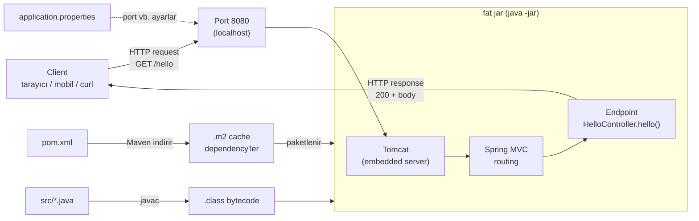

# Modül 0 — Backend nedir? + Proje iskeleti

> **Commit:** `b8713f8` · **Önceki:** — · **Sonraki:** Modül 1 (HTTP derinlemesine) · [↩ Ders defteri](README.md)

## 🎯 Hedefler: bu modülün sonunda…

- [ ] [Client–server modelini](#client-server) ve [request/response döngüsünü](#request-response) çizerek anlatabilirsin.
- [ ] İş kurallarının [neden backend'de durduğunu](#neden-backend) üç gerekçeyle açıklayabilirsin.
- [ ] Bir [HTTP cevabının](#http-cevap) parçalarını ve [status code](#status-code) sınıflarını okuyabilirsin.
- [ ] [Endpoint](#endpoint), [port](#port) ve [localhost](#localhost) kavramlarını açıklayabilirsin.
- [ ] Bir Java/Spring Boot projesinin [derlenip](#derleme-zinciri) [tek jar](#fat-jar) olarak çalıştığını anlatabilirsin.

---

## 🗺️ Kavram haritası



---

## A. Backend kavramları (asıl konu)

### <a id="client-server"></a>A1. Client–Server modeli
- **Tanım:** İsteği başlatan taraf **client**, isteği karşılayıp cevap veren taraf **server**'dır. Kullanıcının gördüğü kısım frontend, arkada kural işleten ve veri tutan kısım backend'dir.
- **Neden böyle?** → [A3](#neden-backend)
- **Projede:** Client = `curl` / tarayıcı. Server = [`TaskManagerApplication`](../src/main/java/com/example/taskmanager/TaskManagerApplication.java).
- **Bağlantılı:** [Request/Response](#request-response) · [Port](#port) · [Embedded server](#fat-jar)

### <a id="request-response"></a>A2. Request / Response döngüsü
- **Tanım:** Client bir **istek** gönderir, server **tam olarak bir cevap** döner. İletişimi her zaman client başlatır.
- **Kaputun altı:** Bu sadece *bir* iletişim desenidir. Push, polling, SSE ve WebSocket gibi alternatifler var → Modül 9.
- **Bağlantılı:** [HTTP cevabı](#http-cevap) · [Endpoint](#endpoint)

### <a id="neden-backend"></a>A3. İş kuralları neden backend'de?
| Gerekçe | Açıklama |
|---------|----------|
| **Güvenlik** | Client'taki koda kullanıcı müdahale edebilir. Yetki kontrolü her zaman server'da yapılır. |
| **Ortak veri** | Telefon ve bilgisayar aynı veriyi görsün diye veri tek bir merkezde durur. |
| **Single source of truth** | Web, iOS ve Android aynı backend'i kullanır. Kurallar bir kez yazılır. |
- **Bağlantılı:** [Client–Server](#client-server) · Modül 5 (yetkilendirme)

### <a id="http-cevap"></a>A4. HTTP cevabının anatomisi
```
HTTP/1.1 200                              ← status line (protokol + status code)
Content-Type: text/plain;charset=UTF-8    ← header: body'nin türü
Content-Length: 36                        ← header: body'nin boyutu (bayt)
                                          ← boş satır = header'lar bitti
Merhaba! Backend'imiz çalışıyor.          ← body
```
- **Eksik kalan:** Request'in anatomisi ve HTTP'nin aslında TCP üzerinde düz metin olduğu → **Modül 1**.
- **Bağlantılı:** [Status code](#status-code) · [Endpoint](#endpoint)

### <a id="status-code"></a>A5. Status code sınıfları
| Sınıf | Anlamı | Hata kimde? | Örnek |
|-------|--------|-------------|-------|
| 2xx | Başarılı | — | `200 OK` (`/hello`) |
| 3xx | Yönlendirme | — | `301`, `302` |
| 4xx | İstemci hatası | Client'ta | `404 Not Found` (`/olmayan-sayfa`) |
| 5xx | Sunucu hatası | Bizde | `500 Internal Server Error` |
- **Bağlantılı:** [HTTP cevabı](#http-cevap) · Modül 3 (hata yönetimi)

### <a id="endpoint"></a>A6. Endpoint
- **Tanım:** Bir **HTTP method'u + adres (path)** ikilisi. `GET /hello` ile `POST /hello` **farklı** endpoint'lerdir.
- **Projede:** [`HelloController`](../src/main/java/com/example/taskmanager/HelloController.java) → `@GetMapping("/hello")`
- **Bağlantılı:** [Request/Response](#request-response) · Modül 1 (method'lar) · Modül 3 (REST tasarımı)

### <a id="port"></a>A7. Port
- **Tanım:** Bir makinedeki programları ayırt eden numara. IP adresi binanın adresiyse, port daire numarasıdır. Uygulamamız **8080**'i dinliyor.
- **Projede:** [`application.properties`](../src/main/resources/application.properties) → `server.port=8080`
- **Bağlantılı:** [localhost](#localhost) · [Config ayrımı](#config)

### <a id="localhost"></a>A8. localhost
- **Tanım:** "Bu makinenin kendisi" (`127.0.0.1`). Container'daki `localhost` ile senin bilgisayarındaki `localhost` **farklı makinelerdir**.
- **Bağlantılı:** [Port](#port) · Modül 11 (sunucuyu dışarı açmak)

### <a id="config"></a>A9. Config'i koddan ayırmak
- **Tanım:** Port, veritabanı adresi gibi ortama göre değişen değerler koda gömülmez, ayar dosyasına ya da ortam değişkenine yazılır.
- **Neden?** Aynı jar geliştirme ortamında, testte ve canlıda farklı ayarlarla çalışabilsin diye.
- **Bağlantılı:** [Port](#port) · Modül 6 (secret'lar) · Modül 11 (deployment)

---

## B. Altyapı (yan konu, "lazım olduğu kadar")

### <a id="derleme-zinciri"></a>B1. Derleme zinciri: JDK, bytecode, JVM
```
HelloController.java ──javac──▶ HelloController.class ──JVM──▶ çalışan program
```
- **JDK** = derleyici + çalıştırıcı. **Bytecode** işletim sisteminden bağımsızdır: "write once, run anywhere".
- **Nerede:** `/usr/lib/jvm/java-21-openjdk-amd64/`
- **Bağlantılı:** [Maven](#maven) · [Fat jar](#fat-jar)

### <a id="maven"></a>B2. Maven ve `pom.xml`
- **Tanım:** Build tool. Bağımlılıkları indirir, derler, paketler. [`pom.xml`](../pom.xml) projenin tarifidir ve aynı tarif herkese aynı sonucu verir (**reproducible build**).
- **Nerede:** `/opt/apache-maven-3.9.11/`
- **Bağlantılı:** [Dependency](#dependency) · [src ve target](#src-target)

### <a id="dependency"></a>B3. Dependency, transitive dependency ve `.m2`
- **Tanım:** 1 starter yazdık, ama uygulama 35 jar kullanıyor. Kütüphanelerin de bağımlılıkları var (transitive). `.m2/repository` ise yerel önbellek: bir kez indirilir, her projede kullanılır.
- **Nerede:** `/root/.m2/repository/` (yapı: `groupId/artifactId/version`)
- **Bağlantılı:** [Maven](#maven) · [Fat jar](#fat-jar)

### <a id="src-target"></a>B4. `src/` ve `target/`
- `src/` = insanın yazdığı → git'te. `target/` = makinenin ürettiği → [`.gitignore`](../.gitignore) ile dışarıda bırakılır, çünkü her an yeniden üretilebilir.
- **Bağlantılı:** [Maven](#maven) · [Git](#git)

### <a id="fat-jar"></a>B5. Fat jar ve embedded server
- **Tanım:** 20 MB'lık jar = bizim 2 sınıfımız + 35 kütüphane (**Tomcat dahil**). Sunucuya Tomcat kurmaya gerek yok, `java -jar` yeterli.
- **Neden önemli?** Deployment tek bir dosyayı kopyalamaya iner.
- **Bağlantılı:** [Derleme zinciri](#derleme-zinciri) · [Client–Server](#client-server) · Modül 11 (Docker)

### <a id="git"></a>B6. Git, remote ve push
- **Tanım:** Git dağıtık bir sistemdir, her kopya tüm geçmişi taşır. `origin` = GitHub'daki uzak repo. `git push` = yerel commit'leri oraya gönderir.
- **Repo:** https://github.com/xalfard/task-manager
- **Bağlantılı:** [Geçici makineler](#ephemeral)

### <a id="ephemeral"></a>B7. Geçici (ephemeral) makineler
- **Tanım:** Çalıştığımız bulut container'ı her an silinebilir. Kalıcı olan şeyler makinenin **dışında** tutulur: git, veritabanı, yedekler.
- **Backend dersi:** Gerçek sunucular da böyle düşünülür. Sunucu "evcil hayvan" değil "sürü hayvanı"dır (*cattle, not pets*).
- **Bağlantılı:** [Git](#git) · Modül 4 (veritabanı) · Modül 11

---

## 🧭 Ortam haritası

| Ne | Nerede |
|----|--------|
| Proje | `/home/user/task-manager` (container) · [GitHub](https://github.com/xalfard/task-manager) |
| JDK 21 | `/usr/lib/jvm/java-21-openjdk-amd64/` |
| Maven 3.9.11 | `/opt/apache-maven-3.9.11/` |
| İndirilen kütüphaneler | `/root/.m2/repository/` (senin bilgisayarında: `~/.m2/repository/`) |
| Çalıştırılabilir dosya | `target/task-manager-0.0.1-SNAPSHOT.jar` |

## ⌨️ Komutlar

| Komut | Ne yapar |
|-------|----------|
| `mvn package` | Derle + jar üret |
| `mvn spring-boot:run` | Derle + çalıştır (geliştirme sırasında) |
| `java -jar target/*.jar` | Üretilmiş jar'ı çalıştır (sunucuda böyle) |
| `curl -i localhost:8080/hello` | İstek at, header'larla birlikte cevabı göster |
| `git add -A && git commit -m "..." && git push` | Değişiklikleri kaydet ve GitHub'a gönder |

---

## ✅ Kontrol soruları

1. Client ve server nedir? Request/response döngüsünü çiz. → [A1](#client-server), [A2](#request-response)
2. "Bu görevi silebilir mi?" kontrolü neden frontend'de yapılmaz? → [A3](#neden-backend)
3. `GET /hello` ile `POST /hello` aynı endpoint mi? → [A6](#endpoint)
4. Bir HTTP cevabının parçaları nelerdir? → [A4](#http-cevap)
5. 404 alınca hata kimde, 500 alınca kimde? → [A5](#status-code)
6. Container'daki uygulamaya kendi tarayıcından `localhost:8080` ile neden ulaşamazsın? → [A7](#port), [A8](#localhost)
7. Port neden koda değil de `application.properties`'e yazıldı? → [A9](#config)
8. `.java` dosyasından çalışan programa giden zincir nedir? → [B1](#derleme-zinciri)
9. Tek bir starter yazdık, neden 35 jar geldi? → [B3](#dependency)
10. Jar neden 20 MB? Bu deployment'ı nasıl kolaylaştırır? → [B5](#fat-jar)
11. `target/` neden git'te yok? → [B4](#src-target)

## 🏠 Ödev
- [ ] Projeyi kendi bilgisayarında `git clone` ile çek, IntelliJ'de aç, çalıştır.
- [ ] `/hakkimda` endpoint'ini ekle, commit at, push et.

## ⚠️ Bu modülde yüzeysel kalanlar → Modül 1 ve 2'de derinleşecek
- HTTP'nin **request** tarafı ve HTTP'nin aslında **TCP üzerinde düz metin** olduğu → Modül 1
- İstek sunucuya **nasıl ulaşıyor**: DNS, IP, TCP handshake → Modül 1
- İstek sunucunun **içinde ne oluyor**: Tomcat thread'leri, `DispatcherServlet`, annotation'ların arkasındaki mekanizma → Modül 2
- **Aynı anda çok istek** gelince ne oluyor: process, thread, concurrency → Modül 2
